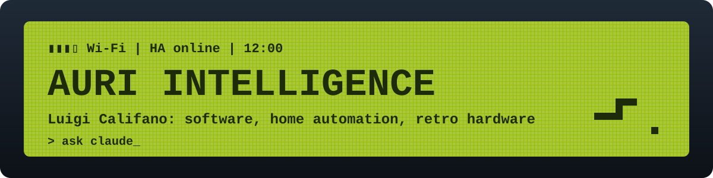

<p align="center">
  
</p>

<p align="center"><b>Italiano</b> | <a href="README.md">English</a></p>

<p align="center">
  
  
  
  
  
  
</p>

### Ciao, sono Luigi

Sviluppatore software. Costruisco **AurI**, un ecosistema personale di piccoli servizi che gestiscono la mia casa e le mie giornate: domotica, calendario, allenamento, ricette, tutti collegati tra loro e a un assistente AI.

Nel tempo libero do una seconda vita al vecchio hardware.

### Progetto in evidenza

<table>
<tr>
<td width="50%">

**[auri-3310](https://github.com/auri-intelligence/auri-3310)**

Un vero telefono del 2000 con un cervello nuovo basato su ESP32-S3. Scocca, schermo e tasti originali; in più Wi-Fi, controllo di Home Assistant e una shell Claude che chiede conferma prima di agire.

`MicroPython` `KiCad` `open hardware`

</td>
<td width="50%">

```text
  Telefono            Raspberry Pi
  ESP32-S3 --Wi-Fi--> AurI Bridge --> Claude, Gemini
  AurI OS  <--------  (Python)   --> Home Assistant
```

Prova il simulatore: `cd firmware && python sim.py`

</td>
</tr>
</table>

### L'ecosistema AurI

| Area | Cosa fa |
|---|---|
| core, common | backend e librerie condivise |
| domus, nest | domotica sopra Home Assistant |
| calendar, dine, fitness | vita di tutti i giorni: agenda, pasti, allenamento |
| control, ui-shared | dashboard web e componenti UI condivisi |
| deploy | deploy self-hosted sul mio server di casa |

Per ora sono quasi tutti privati: il 3310 è il primo a diventare pubblico.

### Contatti

<p>
  <a href="https://www.instagram.com/auri.intelligence/"></a>
  <a href="https://www.tiktok.com/@auri.intelligence"></a>
</p>

Segui i lavori su Instagram e TikTok, oppure apri una issue su un qualsiasi repo pubblico, anche solo per fare una domanda.
