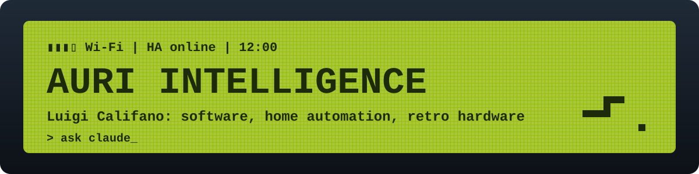

<p align="center">
  
</p>

<p align="center">
  
  
  
  
  
  
</p>

### Hi, I'm Luigi

Software developer from Italy. I build **AurI**, a personal ecosystem of small services that run my home and my day: home automation, calendar, fitness, recipes, all talking to each other and to an AI assistant.

In my spare time I give old hardware a second life.

### Featured project

<table>
<tr>
<td width="50%">

**[auri-3310](https://github.com/auri-intelligence/auri-3310)**

A real phone from 2000 with a brand new ESP32-S3 brain. Original shell, screen and keys; new Wi-Fi, Home Assistant control and a Claude shell that asks before acting.

`MicroPython` `KiCad` `open hardware`

</td>
<td width="50%">

```text
  Phone               Raspberry Pi
  ESP32-S3 --Wi-Fi--> AurI Bridge --> Claude, Gemini
  AurI OS  <--------  (Python)   --> Home Assistant
```

Try the simulator: `cd firmware && python sim.py`

</td>
</tr>
</table>

### The AurI ecosystem

| Area | What it does |
|---|---|
| core, common | shared backend and libraries |
| domus, nest | home automation on top of Home Assistant |
| calendar, dine, fitness | everyday life: agenda, meals, training |
| control, ui-shared | web dashboard and shared UI components |
| deploy | self-hosted deployment on my home server |

Most of these are private for now: the 3310 is the first to go public.

### Get in touch

<p>
  <a href="https://www.instagram.com/auri.intelligence/"></a>
  <a href="https://www.tiktok.com/@auri.intelligence"></a>
</p>

Follow the builds on Instagram and TikTok, or open an issue on any public repo, even just to ask something.
